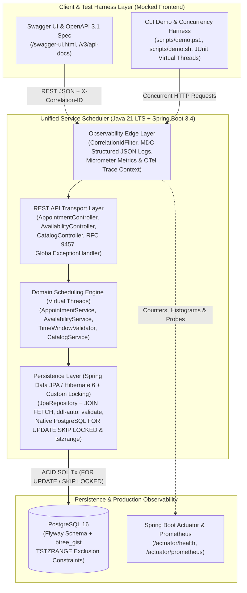
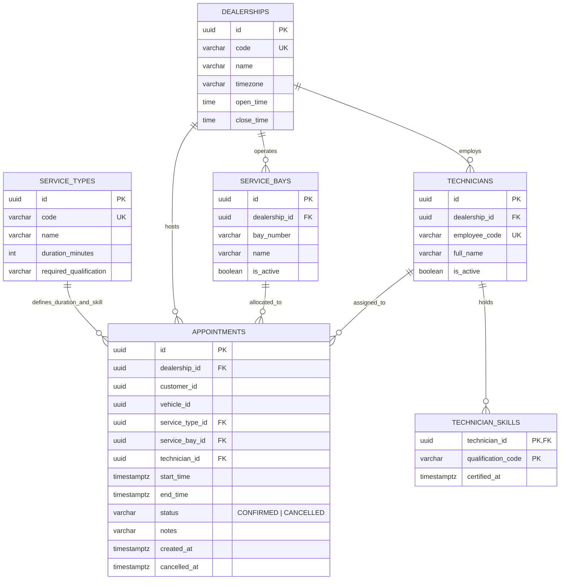
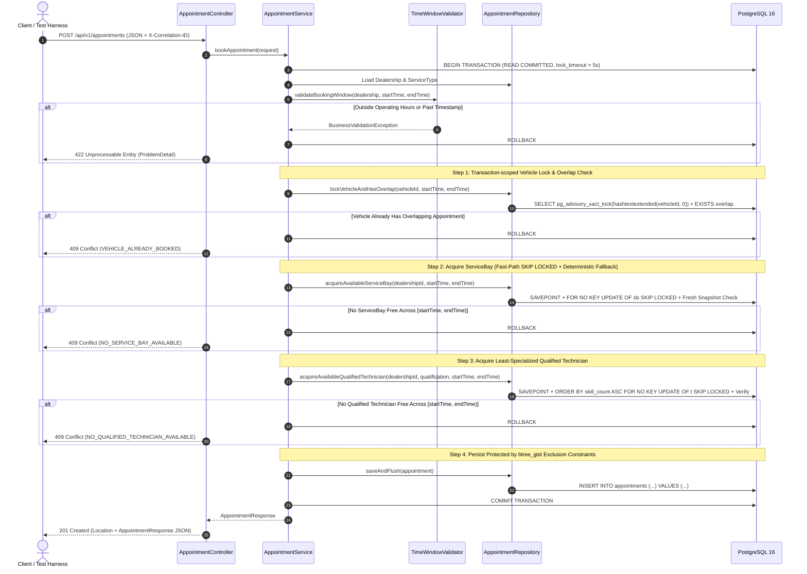

# System Design Document: The Unified Service Scheduler (Scenario A)

## 1. Executive Summary & Architectural Assumptions

The **Unified Service Scheduler** replaces manual automotive dealership service booking workflows with an automated, resource-constrained appointment scheduling engine. Before confirming any booking, the engine atomically verifies and allocates both a physical **ServiceBay** and a qualified **Technician** at the target dealership for the full duration of the requested service, guaranteeing zero double-booking even under bursty concurrent traffic.

### Key Architectural Assumptions (Handling Ambiguity)

Real-world dealership scheduling involves domain nuances not fully enumerated in a high-level brief. The following explicit assumptions govern this architecture:

1. **Deterministic Service Duration & Qualification Mapping:** Each `ServiceType` (e.g., *Standard Oil & Filter Change*, *Front & Rear Brake Overhaul*, *EV High-Voltage Battery Diagnostic*, *Statutory MOT Inspection*) defines a fixed `duration_minutes` (`1..480`) and a single `required_qualification` code. A technician must hold that active qualification in `technician_skills` to perform the service.
2. **Automatic Resource Assignment & Specialist Preservation:** Customers specify `dealershipId`, `customerId`, `vehicleId`, `serviceTypeId`, and `desiredStartTime`. Customers do not manually pick an individual bay or technician; the engine automatically assigns an available active bay and qualified technician. When multiple qualified technicians are free, the engine prefers the **least-specialized qualified technician** (`skill_count ASC`) so scarce multi-certified specialists (such as EV high-voltage technicians) remain free for specialized bookings.
3. **Bounded-Context Separation for Customer & Vehicle Master Data:** In an automotive retail platform, Customer CRM and Vehicle Registry live in dedicated bounded contexts. This service accepts `customerId` and `vehicleId` as immutable UUID references without coupling to external master tables, while enforcing a physical invariant that the **same `vehicleId` cannot hold overlapping confirmed appointments** across any bay or dealership.
4. **Timezone-Aware Operating Hours & UTC Persistence:** All timestamps are persisted and exchanged in **UTC (`TIMESTAMPTZ` / ISO-8601)**. Each dealership configures its local `open_time`, `close_time` (default `08:00`–`18:00`), and IANA `timezone` (e.g., `Europe/London`, `UTC`). The entire `[start_time, end_time)` window must fall within a single local operating day `[open_time, close_time]` and must not start in the past.
5. **Half-Open Time Intervals `[start_time, end_time)`:** Two intervals $[S_A, E_A)$ and $[S_B, E_B)$ overlap if and only if $S_A < E_B \land E_A > S_B$. Enforcing half-open bounds (`'[)'` in PostgreSQL `tstzrange`) allows back-to-back bookings (e.g., `[09:00, 10:00)` followed immediately by `[10:00, 11:00)`) without false conflicts.
6. **Whole-Duration Resource Continuity:** A vehicle on a hydraulic lift cannot switch bays mid-service. Availability queries and booking transactions verify that **one specific bay** and **one specific qualified technician** remain continuously free across the entire `[start_time, end_time)` window, rejecting split availability across separate resources.
7. **Cancellation & Immediate Capacity Recovery:** Appointments transition from `CONFIRMED` to `CANCELLED`. Database exclusion constraints apply specifically `WHERE (status = 'CONFIRMED')`, so cancelling an appointment immediately releases both the bay and technician for new bookings while preserving an immutable audit trail (`cancelled_at`).

---

## 2. System Architecture Diagram

---

## 3. Component Roles & Database Schema

### Application Components

| Package / Layer | Key Classes | Architectural Role |
| :--- | :--- | :--- |
| **Observability Edge (`observability`)** | `CorrelationIdFilter`, `SchedulerMetrics` | Extracts or generates `X-Correlation-ID`, populates SLF4J `MDC` for structured JSON logs, echoes correlation headers on every response, and records Micrometer business counters and booking latency histograms. |
| **REST Transport (`api`, `exception`)** | `AppointmentController`, `AvailabilityController`, `CatalogController`, `GlobalExceptionHandler` | Exposes versioned `/api/v1/*` endpoints, validates incoming DTOs via Jakarta Bean Validation, maps outcomes to semantic HTTP status codes (`201`, `200`, `400`, `404`, `409`, `422`), and formats all errors as RFC 9457 `ProblemDetail` (`application/problem+json`). |
| **Domain Service (`service`)** | `AppointmentService`, `AvailabilityService`, `TimeWindowValidator`, `CatalogService` | Computes `endTime = startTime + durationMinutes`, enforces dealership operating hours in the dealership's local IANA timezone via injected `java.time.Clock`, calculates continuous slot capacity, and orchestrates atomic `@Transactional` booking lifecycles. |
| **JPA & Locking Persistence (`repository`, `domain`)** | `AppointmentRepository`, `AppointmentLockingRepositoryImpl`, `DealershipRepository`, `ServiceTypeRepository`, `ServiceBayRepository`, `TechnicianRepository` | Models rich domain `@Entity` aggregates with `FetchType.LAZY` and `JOIN FETCH` queries (`open-in-view: false`, `ddl-auto: validate`), combined with a Spring Data custom repository fragment executing native PostgreSQL `pg_advisory_xact_lock`, `FOR UPDATE SKIP LOCKED`, post-lock fresh-snapshot verification, and `saveAndFlush()` for immediate GiST constraint enforcement. |
| **Schema Management (`db/migration`, `db/seed`)** | `V1__init_schema.sql`, `R__seed_demo_data.sql` | Flyway manages immutable production DDL (`db/migration`) separately from repeatable dealership seed fixtures (`db/seed`), keeping integration tests isolated while providing zero-setup demo data in local and Docker runs. |

### Entity-Relationship & Relational Schema

**Relational Integrity Invariants:**
* Composite foreign keys `(service_bay_id, dealership_id)` and `(technician_id, dealership_id)` physically prevent cross-dealership resource assignment.
* Check constraints enforce `open_time < close_time`, `duration_minutes BETWEEN 1 AND 480`, `end_time > start_time`, and `status IN ('CONFIRMED', 'CANCELLED')`.

---

## 4. Data Flow & Defense-in-Depth Concurrency Control

### Appointment Booking Sequence

### Three-Layer Concurrency & Race-Condition Elimination

A naive application-level "check availability then insert" suffers from **Time-Of-Check to Time-Of-Use (TOCTOU)** race conditions. Conversely, a naive single-pass `FOR UPDATE SKIP LOCKED` on resource master rows introduces subtle failure modes when concurrent bookings target *different* time slots on the same bay or hit PostgreSQL `READ COMMITTED` snapshot boundaries. Our engine implements a three-layer defense-in-depth strategy:

1. **Strict Lock Hierarchy (Mathematically Deadlock-Free):**
   Every booking transaction acquires locks strictly in top-down order:
   `(1) pg_advisory_xact_lock(vehicle_id)` $\rightarrow$ `(2) service_bays` $\rightarrow$ `(3) technicians`.
   When multiple rows within a table are locked in fallback mode, they are locked in ascending `id` order (`ORDER BY id ASC`). Because no two transactions can invert this partial order, circular lock waits (deadlocks) cannot occur.

2. **Hybrid Fast-Path `SKIP LOCKED` + `SAVEPOINT` Fresh-Snapshot Verification + Contention Fallback:**
   * **Fast Path:** Candidate bays and technicians without overlapping confirmed appointments are queried with `FOR NO KEY UPDATE ... SKIP LOCKED LIMIT 1` inside a lightweight JDBC `SAVEPOINT`. Concurrent requests for the *same* time slot at a multi-bay dealership immediately lock distinct bays and technicians in parallel without blocking one another, and `FOR NO KEY UPDATE` avoids unnecessary contention with foreign-key `FOR KEY SHARE` checks. Once locked, a `NOT EXISTS` query executes under a **fresh post-lock `READ COMMITTED` statement snapshot**, eliminating the microsecond window where a prior lock holder committed right after the outer `SELECT` snapshot began. If a candidate fails post-lock verification, rolling back to the candidate `SAVEPOINT` immediately releases that row lock so zero out-of-order locks are retained.
   * **Contention Fallback:** Because `service_bays` and `technicians` have one row per physical resource, an in-flight transaction booking *Monday 09:00* briefly holds a row lock on `Bay 1`. If a concurrent request for *Tuesday 14:00* on a 1-bay dealership used `SKIP LOCKED` alone, it would skip `Bay 1` and falsely return `409 Conflict`. When the fast path yields no rows (with zero fast-path row locks held), the repository falls back to locking the dealership's active resources in strict `id ASC` order (`FOR NO KEY UPDATE`) and re-evaluating overlap on a fresh snapshot—waiting ~1 ms for the unrelated transaction to commit and succeeding with zero false conflicts and zero AB-BA deadlock possibility.

3. **PostgreSQL `btree_gist` Exclusion Constraints (Physical Storage Guarantee):**
   The `appointments` table enforces three partial GiST exclusion constraints using half-open timestamp ranges `tstzrange(start_time, end_time, '[)')`:
   * `excl_appointments_bay_overlap`: prevents two `CONFIRMED` appointments from overlapping on the same `service_bay_id`.
   * `excl_appointments_tech_overlap`: prevents two `CONFIRMED` appointments from overlapping on the same `technician_id`.
   * `excl_appointments_vehicle_overlap`: prevents two `CONFIRMED` appointments from overlapping on the same `vehicle_id`.
   Even if an application bug bypassed repository checks, PostgreSQL physically rejects any overlapping write with SQLState `23P01` (`exclusion_violation`), which the repository translates cleanly to `409 Conflict`.

---

## 5. Technology Choices & Justifications

| Layer / Concern | Chosen Technology | Architectural Justification |
| :--- | :--- | :--- |
| **Language & Runtime** | **Java 21 LTS (Virtual Threads)** | Project Loom Virtual Threads (`spring.threads.virtual.enabled=true`) unmount carrier OS threads during blocking JDBC lock waits, delivering high-concurrency throughput comparable to async/reactive stacks while preserving clean, debuggable imperative transaction code and immutable `record` types. |
| **Application Framework** | **Spring Boot 3.4** | Production-proven dependency injection, declarative `@Transactional` management, native RFC 9457 `ProblemDetail` error responses, Jakarta Bean Validation, and out-of-the-box structured logging. |
| **Persistence & ORM** | **Spring Data JPA (Hibernate 6) + Custom Native SQL Fragment** | Combines expressive `@Entity` domain modeling, schema validation (`ddl-auto: validate`), and N+1-free `JOIN FETCH` queries (`open-in-view: false`) with a custom repository fragment for PostgreSQL-specific concurrency primitives (`FOR UPDATE OF sb SKIP LOCKED`, `pg_advisory_xact_lock`, `tstzrange &&`). Using `saveAndFlush()` forces immediate SQL execution inside the transaction boundary rather than deferring writes to commit time. |
| **Database** | **PostgreSQL 16 (`btree_gist`)** | Industry-leading ACID relational engine with native range types (`tstzrange`), GiST exclusion constraints for storage-level overlap prevention, `SKIP LOCKED` row locking, and 64-bit transaction-scoped advisory locks. |
| **Schema Migrations** | **Flyway** | Guarantees deterministic, version-controlled schema evolution across local dev, Testcontainers CI, and Docker production deployments, with clean separation between DDL (`db/migration`) and demo fixtures (`db/seed`). |
| **Observability** | **Actuator + Micrometer + Prometheus + OTel Bridge** | Exposes `/actuator/prometheus` histograms/counters, `/actuator/health` liveness/readiness probes, W3C trace context propagation, and Logstash/ECS JSON structured logs. |
| **API Contract & Harness** | **SpringDoc OpenAPI 3.1 + Swagger UI** | Generates an accurate OpenAPI 3.1 contract (`/v3/api-docs`) and interactive browser harness (`/swagger-ui.html`) directly from controller annotations and validation constraints. |
| **Verification Suite** | **JUnit 5 + Testcontainers (`postgres:16-alpine`)** | Executes repository, HTTP API, and 50-thread `CyclicBarrier` concurrency stress tests against a real PostgreSQL 16 engine rather than H2 mocks, proving that `btree_gist` and row-locking semantics behave identically to production. |

---

## 6. Observability, Scalability & Production Readiness

### Observability Strategy
1. **Structured Logging & Correlation Propagation:**
   * `CorrelationIdFilter` extracts `X-Correlation-ID` (or generates a UUIDv4), binds `correlationId` into SLF4J `MDC`, and returns `X-Correlation-ID` on every HTTP response and `ProblemDetail` payload.
   * Spring Boot 3.4 native structured logging (`logstash` JSON format in Docker/production profiles) outputs `timestamp`, `level`, `correlationId`, `traceId`, `spanId`, `logger`, and contextual booking attributes (`dealershipId`, `serviceTypeId`, `appointmentId`). Customer PII is never logged.
2. **Domain & Infrastructure Metrics (`/actuator/prometheus`):**
   * `scheduler_booking_requests_total{outcome="confirmed|conflict_bay|conflict_technician|conflict_vehicle|validation_error", dealership_id="..."}`: Counter tracking booking conversion and pinpointing dealership capacity bottlenecks (e.g., a spike in `conflict_technician` signals a shortage of certified EV technicians at that site).
   * `scheduler_booking_duration_seconds`: Timer/histogram measuring end-to-end transactional booking and lock-wait latency (`p50`, `p95`, `p99`), complemented by HikariCP pool metrics (`hikaricp_connections_active`, `hikaricp_connections_pending`).
3. **Distributed Tracing:**
   * `micrometer-tracing-bridge-otel` automatically instruments incoming HTTP requests and propagates W3C `traceparent` headers, ready for zero-code export to an OpenTelemetry Collector (Grafana Tempo / Jaeger / Datadog).
4. **Health & Readiness Probes:**
   * `/actuator/health/liveness` and `/actuator/health/readiness` verify JVM liveness and active PostgreSQL connection pool responsiveness for Kubernetes or Docker Compose orchestration.

### Scalability & Future Evolution
* **Stateless Horizontal Scaling:** Because all concurrency coordination lives inside PostgreSQL transactions rather than JVM memory, multiple scheduler instances scale horizontally behind any load balancer without sticky sessions.
* **Read/Write Workload Separation:** Dealership portals typically exhibit a high `GET /availability` to `POST /appointments` ratio (10:1–50:1). Read-only `@Transactional(readOnly = true)` availability queries can be routed to PostgreSQL read replicas while booking writes target the primary node.
* **Time-Range Partitioning:** As historical appointment volume grows across thousands of dealerships, partitioning `appointments` or archiving completed/historical quarters keeps active GiST indexes compact in shared buffers.

---

## 7. GenAI Collaboration in the Design Phase

Generative AI was used as an architectural sparring partner during system design under strict engineering direction and critical verification:

1. **Evaluating Distributed Locks vs. Single-Datastore ACID Guarantees:**
   * *Exploration:* AI was prompted to compare Redis distributed locks (Redlock), PostgreSQL `SERIALIZABLE` isolation, and `READ COMMITTED` pessimistic locking (`FOR UPDATE SKIP LOCKED`) paired with `btree_gist` exclusion constraints.
   * *Engineering Decision:* Adding Redis was rejected because external lock leases can expire during JVM GC pauses and introduce dual-system failure modes without an extra database safety net. `SERIALIZABLE` isolation was also set aside due to high `40001` serialization retry churn when 50 clients target the same dealership simultaneously. Directing the design to PostgreSQL row locks + `btree_gist` kept the architecture operationally lean while providing physical storage-level correctness.
2. **Uncovering & Fixing Subtle `SKIP LOCKED` and Snapshot Edge Cases:**
   * *Critical Verification:* Initial AI-generated SQL relied solely on a single `SELECT ... WHERE NOT EXISTS (...) FOR UPDATE SKIP LOCKED LIMIT 1` query. Human architectural review identified two subtle production defects in that naive pattern:
     1. Locking a `service_bays` row locks the physical bay across *all* timestamps for the duration of the transaction, causing concurrent requests for **non-overlapping** time slots at a 1-bay dealership to skip the locked bay and return false `409 Conflict` errors.
     2. Under PostgreSQL `READ COMMITTED`, `NOT EXISTS` subqueries evaluate against the statement's initial snapshot rather than re-running after lock release.
   * *Refinement:* I directed the design to combine the non-blocking `SKIP LOCKED` fast path with a post-lock fresh-snapshot verification query and a deterministic `ORDER BY id ASC FOR UPDATE` contention fallback, eliminating both false `409`s and snapshot races while remaining deadlock-free.
3. **Specialist Technician Preservation & Continuity Rules:**
   * *Domain Refinement:* AI initially ordered candidate technicians arbitrarily by UUID, which would frequently assign a multi-certified EV specialist to a routine oil change and block subsequent EV diagnostics. Adding `ORDER BY skill_count ASC, t.id ASC` and explicit whole-duration continuity tests ensured realistic dealership resource optimization.
